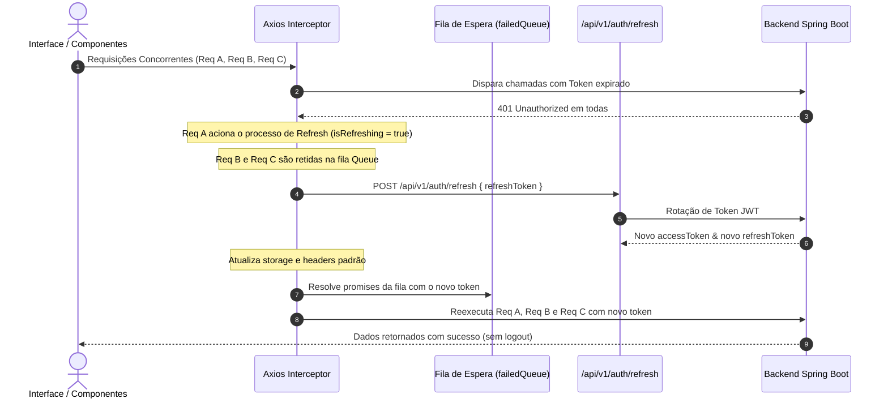
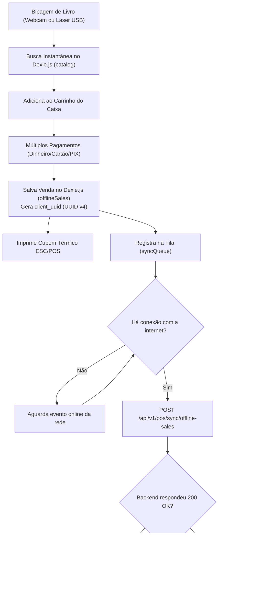

# Documento de Arquitetura de Software (Frontend)

## 1. Visão Geral da Arquitetura

O frontend do **Ecossistema Livraria Multi-Tenant** foi desenhado seguindo uma abordagem modular e orientada a domínios dentro do **Next.js 15 (App Router)** e **React 19**. Ele atende a três perfis operacionais com requisitos de execução distintos:

1. **Backoffice Administrativo (SPA)**: Gestão de catálogo hierárquico, kits fiscais, remessas de estoque multi-filial, conferência cega pós-feira, orçamentos corporativos B2B e emissão fiscal SEFAZ.
2. **PDV Mobile & Balcão (Offline-First PWA)**: Frente de caixa ágil, controle de turnos com fechamento cego, bipagem ótica ultra-rápida (câmera e laser USB), impressão de cupom térmico ESC/POS e sincronização delta idempotente via IndexedDB.
3. **Loja Virtual Pública (E-Commerce Headless SSR)**: Vitrine de alta performance renderizada no servidor para indexação SEO, busca facetada com autocomplete, seletor de variações de SKU e checkout transparente Pagar.me V5.

---

## 2. Topologia de Gerenciamento de Estado

Para garantir escalabilidade e eficiência de memória no navegador, o estado da aplicação é segregado em três camadas bem definidas:

```
┌─────────────────────────────────────────────────────────────┐
│                      ESTADO DE SERVIDOR                     │
│  TanStack Query v5 (React Query)                            │
│  - Cache de dados remotos (produtos, filiais, relatórios)    │
│  - Revalidação em background (staleTime: 5 min)             │
│  - Invalidação seletiva e mutações com feedback otimista    │
└─────────────────────────────────────────────────────────────┘
                              │
┌─────────────────────────────────────────────────────────────┐
│                   ESTADO GLOBAL DE CLIENTE                  │
│  Zustand Stores (com persistência em LocalStorage / Cookie) │
│  - useAuthStore: tokens JWT, perfil do usuário, role, filial│
│  - useTenantStore: ID, nome, slug e cores dinâmicas         │
│  - useCartStore: itens adicionados, frete selecionado       │
└─────────────────────────────────────────────────────────────┘
                              │
┌─────────────────────────────────────────────────────────────┐
│                  BANCO LOCAL OFFLINE-FIRST                  │
│  Dexie.js (IndexedDB versionado: PdvOfflineDb)              │
│  - catalog: cópia local para consulta sem internet          │
│  - cashShifts: registros de turno, suprimento e sangria     │
│  - offlineSales: vendas offline com client_uuid único       │
│  - syncQueue: fila com controle de retentativas e status    │
└─────────────────────────────────────────────────────────────┘
```

---

## 3. Pipeline de Autenticação, Multi-Tenancy & Refresh Token

### 3.1. Headers Mandatórios Injetados
Cada requisição HTTP enviada pelo cliente Axios (`lib/api/client.ts`) é automaticamente enriquecida com os seguintes metadados:
- `X-Tenant-ID`: Identificador UUID do tenant em execução, resolvido a partir do estado ou subdomínio.
- `X-Correlation-ID`: Identificador UUID v4 único por chamada para rastreamento distribuído e observabilidade.
- `Authorization: Bearer <jwt_token>`: Token de acesso do usuário autenticado.

### 3.2. Fila Concorrente de Rotação de Token (401 Interceptor)
Quando múltiplas requisições simultâneas recebem `401 Unauthorized` devido à expiração do access token, a aplicação não dispara múltiplas chamadas de refresh. Em vez disso, ela aplica uma fila de espera:



---

## 4. Arquitetura Multi-Tenant & Branding Dinâmico

O ecossistema é estritamente multi-tenant:
1. **No Backend**: O `X-Tenant-ID` é interceptado e ativa o isolamento em nível de linha no banco de dados (**PostgreSQL Row-Level Security - RLS**).
2. **No Frontend**: O `useTenantStore` consulta `GET /api/v1/auth/tenant-info` na inicialização e injeta a paleta visual do tenant em tempo de execução via CSS Variables no elemento raiz:
   ```css
   :root {
     --primary: /* primaryColor do tenant retornado pela API */;
     --primary-hover: /* cálculo proporcional do tom de destaque */;
     --ring: /* cor de foco */;
   }
   ```
Isso permite que dezenas de livrarias compartilhem a mesma infraestrutura frontend exibindo identidade visual e logos próprios sem rebuild.

---

## 5. Arquitetura Offline-First do PDV (Venda Balcão & Feiras)

Nas feiras e eventos itinerantes, a conexão com a internet pode ser instável ou inexistente. O PDV foi concebido com uma estratégia **Offline-First Nativa**:



### Garantia de Idempotência
Cada venda offline recebe no cliente um identificador imutável `client_uuid` (UUID v4). Caso ocorra falha de rede ou timeout durante a sincronização, o reenvio da mesma venda para `/api/v1/pos/sync/offline-sales` não gera duplicidade no backend nem baixa duplicada de estoque.

---

## 6. Integração com Periféricos & Hardware

1. **Leitura Óptica por Câmera**:
   - Biblioteca `@zxing/library` para decodificação em tempo real de códigos de barras EAN-13 e ISBN-10/13 usando a câmera do tablet/smartphone ou webcam.
2. **Leitor de Código de Barras Laser USB**:
   - Listener de eventos globais de teclado (`keydown`) com buffer de acumulação rápida por tempo (< 50ms entre caracteres). Quando detecta sequência terminada em `Enter`, identifica a entrada como leitor laser e não digitação manual, adicionando o SKU instantaneamente ao carrinho.
3. **Impressão Térmica ESC/POS**:
   - Emissão de cupons térmicos (padrão 80mm e 58mm) e Danfe simplificada da NFC-e via protocolo padrão ESC/POS e `window.print` com media query `@media print`.

---

## 7. Controle de Acesso Baseado em Papéis (RBAC)

| Papel (`UserRole`) | Permissões no Sistema | Rota Inicial |
| :--- | :--- | :--- |
| `SUPER_ADMIN` | Acesso global irrestrito a todos os tenants e filiais | `/admin` |
| `TENANT_ADMIN` | Gestão completa de catálogo, equipe, fiscal e estoque do tenant | `/admin` |
| `STORE_MANAGER` | Gestão de filiais, remessas de estoque e operadores de caixa | `/admin` |
| `ATTENDANT` | Operador do PDV: abertura/fechamento de caixa, sangrias e vendas | `/pdv` |
| `CUSTOMER` | Cliente final da loja: pedidos, rastreio e download de e-books | `/store` |

